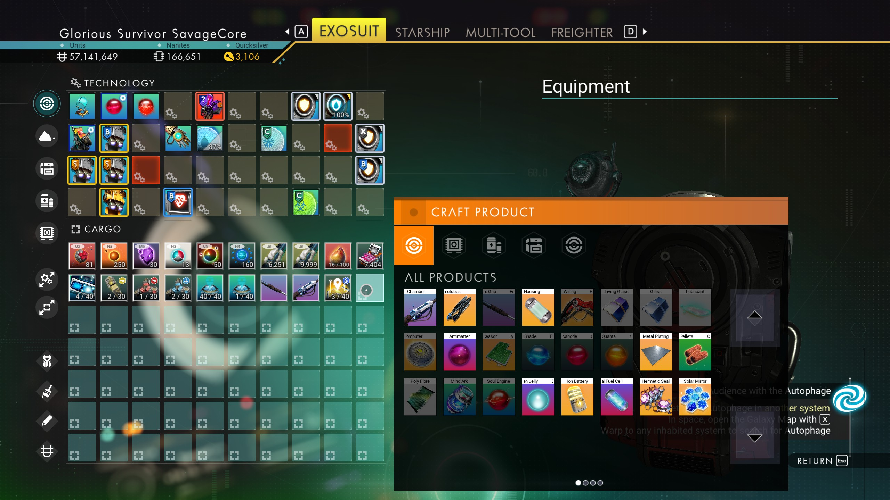
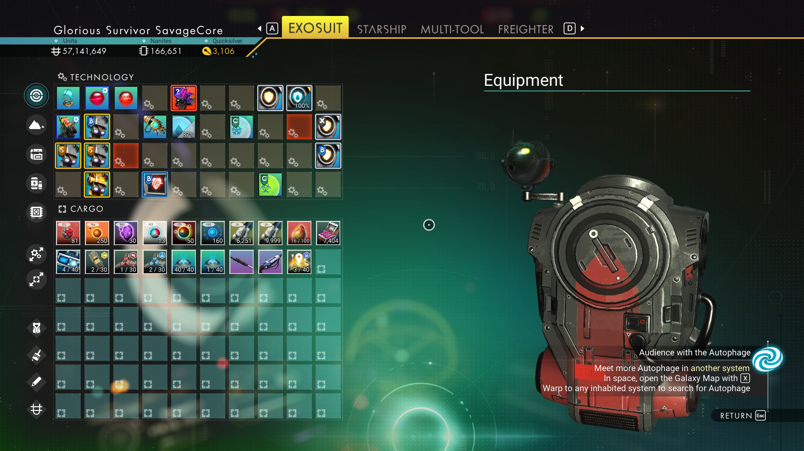

# Bigger Item Grids and Smaller Inventory Slots

See more slots on screen in the inventory and Crafting/Transfer popups.

A [Nozavolochen](https://github.com/Nozavolochen/framework) mod:
the runtime patches are declared in `mod.toml` and applied by the
shared host DLL at game boot.

## What it does

**Inventory:**
Increase visible rows from 5 to **7**, Technology from
3 to **4**.

**Transfer Items and Craft Product popups:** Increases pop-up from
4 by 2 (8 slots per page) to **8 by 3 (24 slots per page)**.

> [!NOTE]
> `popup_pages` and `inventory_grid` must both be `true` in the
> included `mod.toml` for the bigger inventory to function.
> Intro skip and mod-warning skip are separate Nozavolochen mods.





## Install

Requires the **Nozavolochen Framework** file (required dependency,
provides `Binaries/xinput9_1_0.dll`).

Install `dist/Bigger Item Grids and Smaller Inventory Slots.zip` as a
normal mod into `GAMEDATA/MODS` ([Amethyst](https://github.com/ChrisDKN/Amethyst-Mod-Manager)) or copy the mod folder into `GAMEDATA/MODS`.

You should then have:

- `Binaries/xinput9_1_0.dll`: the Nozavolochen host, from the framework
  file (Windows DLL, runs under Proton with
  `WINEDLLOVERRIDES="xinput9_1_0=n,b" %command%`).
- `GAMEDATA/MODS/Bigger Item Grids and Smaller Inventory Slots/`: the
  static UI files (slot/box templates, popup windows, inventory pages),
  plus `mod.toml` with the patch spec and toggles.

After launch, `Binaries/nozavolochen.log` is created to help with debugging.

## Compatibility

Static files: the popup, inventory page, slot and box UI MBINs named
in `src/mod.lua.in`. None of them are stored in this repo: all 19
ship whole as MXML text in `src/mxml` (see `SOURCES` there for
provenance) and compile to MBIN at build time. Every `make release`
rebuilds all 19 outputs from those sources.

Runtime: pattern-scanned hooks against the running NMS.exe, built for
Cosmos v7.06. A game update can shift the patterns; this will be logged
and functionality disabled to prevent issues.

## Build (on Linux)

Requires a full AMUMSS install at `~/AMUMSS` (override with
`AMUMSS_HOME=...`) with `MBINCompiler-linux` fetched, a Rust
toolchain with the `x86_64-pc-windows-gnu` target and mingw for the
host DLL, plus a checkout of the framework repo (override with
`FRAMEWORK_HOME=...`).

```sh
make release      # clean rebuild + verify + pack dist/ zip (default)
make verify       # sanity-check the built outputs
make loader       # build the Nozavolochen host DLL via the framework
make rootzip      # pack the root-install archive (no rebuild)
make clean        # remove build/ and dist/
```

The host lives in the [framework repo](https://github.com/Nozavolochen/framework):
a single `xinput9_1_0.dll` that forwards the 7 XInput exports to
the system DLL and applies the enabled mod specs. The static UI is built
with my [AMUMSS Linux port](https://github.com/SavageCore/AMUMSS/tree/feat/linux-support).

## Game updates / versioning

The mod version is `VERSION` in the `Makefile`. The game version the
script targets is `GameVersion` in `src/mod.lua.in`; the mod spec
pins its patterns to the same build. When No Man's Sky updates, check
`nozavolochen.log` first: any `NOT APPLIED` line names the patch whose
patterns drifted. If the update also changed the vanilla UI files, re-derive the
affected files in `src/mxml` from the new vanilla MBINs (decompile
both, diff, store the new mod MXML) and rebuild.
